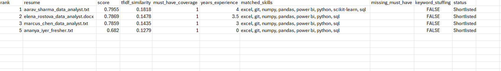

# Automated Resume Screening Tool

An objective, transparent, and reproducible automated resume screening and candidate ranking system built with Python, scikit-learn, and Streamlit. The tool parses multi-format resumes (.pdf, .docx, .txt), standardizes unstructured text, extracts skills using canonical alias-mapped regular expressions, parses years of experience, calculates TF-IDF cosine similarity against target job descriptions, detects adversarial keyword stuffing, and provides structured decision recommendations.

> [!IMPORTANT]
> Synthetic Dataset and Ethical Notice: All resumes, candidate profiles, and contact details in this repository are 100% synthetic and programmatically generated for demonstration and evaluation purposes. Scores and rankings generated by this tool are strictly a ranking aid to help recruiters prioritize reviews; a human recruiter must always make final screening, interview, and hiring decisions.

---

## 1. Problem Statement

Recruitment teams receive hundreds of applications for technical roles. Manual screening processes face recurring operational challenges:

1. Time Inefficiency: Reviewing dozens of unstructured documents across multiple formats consumes significant recruiter hours.
2. Evaluation Inconsistency: Subjective fatigue often leads to varying standards applied across candidates over time.
3. ATS Gaming (Keyword Stuffing): Candidates sometimes repeat buzzwords dozens of times in hidden text, headers, or repeated blocks to artificially boost automated scores.
4. Lack of Explainability: Commercial screening software often functions as an opaque black box, failing to explain why candidates were accepted or rejected.

This project delivers a deterministic, auditable, and explainable screening pipeline that pairs rule-based skill verification and experience heuristics with statistical natural language processing (TF-IDF).

---

## 2. Key Features

- Multi-Format Document Ingestion:
  - Adobe PDF (.pdf) parsed using pdfplumber.
  - Microsoft Word (.docx) parsed using python-docx (paragraphs and table cells).
  - Plain Text (.txt) parsed using standard UTF-8 stream readers.
  - Automatically ignores temporary Office lock files (such as ~$*.docx).
- Text Normalization and Cleaning:
  - Converts text to lowercase, strips URLs and email addresses, and collapses redundant whitespace.
- Skill Extraction (No Fuzzy False Positives):
  - Maps 12 canonical technical competencies to known aliases: python, sql, excel, power bi, pandas, numpy, scikit-learn, machine learning, git, docker, aws, and tableau.
  - Uses strict whole-word regular expressions (\b...\b) with aliases sorted from longest to shortest to prevent prefix collisions (for example, matching postgresql and t-sql before sql).
  - Uses zero fuzzy matching to avoid false positives (for example, html will not match ml, digital will not match git, and excellent will not match excel).
- Experience Duration Parsing:
  - Extracts reported experience numbers in years (supporting integers and decimals such as 4 years, 3.5 yrs, 2+ years).
- Keyword Stuffing Detection:
  - Counts whole-word occurrences per skill.
  - Automatically flags resumes that repeat any single skill beyond an acceptable threshold (default: 6 occurrences).
- Dual Interfaces:
  - Command Line Interface (main.py): Batched terminal execution with summary statistics and automatic CSV report generation.
  - Streamlit Web Dashboard (app.py): Interactive web interface with job description editing, multi-file uploaders, metric cards, Altair score distribution charts, and one-click report downloads.
- Three-Tier Decision Categorization:
  - Shortlisted: Candidates meeting both score and skill coverage thresholds without keyword stuffing.
  - Manual Review: Candidates meeting numeric thresholds but flagged for keyword stuffing.
  - Rejected: Candidates falling below required thresholds or missing core skills.

---

## 3. Technology Stack

| Technology | Role and Purpose |
|---|---|
| Python (3.10+) | Core programming language and runtime environment |
| pandas | Data structuring, metric computation, ranking tables, and CSV generation |
| scikit-learn | TfidfVectorizer (unigram and bigram extraction, English stop words) and cosine_similarity |
| pdfplumber | Text and layout extraction from PDF documents |
| python-docx | Programmatic reading and structure parsing of Microsoft Word (.docx) documents |
| regex (re) | Boundary-guarded pattern matching, text cleaning, and keyword frequency counting |
| Streamlit | Interactive web application framework for recruiter dashboards |
| altair | Declarative statistical data visualization for candidate score comparisons |

---

## 4. Repository Structure

```text
Automated Resume Screening Tool/
├── data/
│   └── job_description.txt       # Target Data Analyst job description
├── docs/                         # Architecture and design notes
├── images/                       # Interface screenshots and workflow visual assets
│   ├── 01_folder_structure.png
│   ├── 02_sample_resumes.png
│   ├── 03_terminal_output.png
│   ├── 04_ranking_csv.png
│   ├── 05_shortlisted.png
│   ├── 06_streamlit_dashboard.png
│   └── 07_ranking_table.png
├── outputs/                      # Screening output spreadsheets
│   ├── ranking_report.csv        # Comprehensive ranked candidate dataset
│   ├── shortlisted.csv           # Shortlisted candidates meeting all criteria
│   └── rejected.csv              # Candidates below threshold or missing must-haves
├── resumes/                      # 10 synthetic candidate resumes (7 .txt, 3 .docx)
│   ├── aarav_sharma_data_analyst.txt
│   ├── ananya_iyer_fresher.txt
│   ├── carlos_ramirez_web_developer.txt
│   ├── elena_rostova_data_analyst.docx
│   ├── julian_vance_data_scientist.docx
│   ├── liam_oconnor_python_excel.docx
│   ├── marcus_chen_data_analyst.txt
│   ├── priya_patel_sql_excel.txt
│   ├── sophie_dubois_marketing.txt
│   └── vikram_malhotra_keyword_stuffed.txt
├── src/                          # Modular Python source package
│   ├── __init__.py
│   ├── cleaner.py                # Text normalization and whitespace collapse
│   ├── extractor.py              # File discovery and multi-format text extractors
│   ├── scorer.py                 # TF-IDF, skill coverage, experience scoring, and ranking
│   └── skills.py                 # Skills dictionary, regex extractor, and stuffing detector
├── .env.example                  # Environment configuration template
├── .gitignore                    # Git exclusion rules for environments, caches, and OS files
├── app.py                        # Streamlit web dashboard entry point
├── generate_samples.py           # Synthetic resume and sample data generator script
├── main.py                       # Command line batch screening pipeline
├── README.md                     # Project documentation
└── requirements.txt              # Production dependency manifest
```

---

## 5. Installation and Setup

### Prerequisites
- Python 3.10, 3.11, or 3.12 installed on your machine.
- Git installed (optional, for cloning).

---

### Setup on Windows (PowerShell or Command Prompt)

1. Navigate to the project root directory:
   ```powershell
   cd "C:\path\to\Automated Resume Screening Tool"
   ```

2. Create and activate a virtual environment:
   ```powershell
   python -m venv venv
   .\venv\Scripts\activate
   ```

3. Install project dependencies:
   ```powershell
   pip install -r requirements.txt
   ```

4. Generate synthetic candidate resumes:
   ```powershell
   python generate_samples.py
   ```

5. Run the command line screening pipeline:
   ```powershell
   python main.py
   ```

6. Launch the Streamlit web dashboard:
   ```powershell
   python -m streamlit run app.py
   ```
   The application will open in your default browser at http://localhost:8501.

---

### Setup on macOS and Linux (Terminal)

1. Navigate to the project directory:
   ```bash
   cd "Automated Resume Screening Tool"
   ```

2. Create and activate a virtual environment:
   ```bash
   python3 -m venv venv
   source venv/bin/activate
   ```

3. Install project dependencies:
   ```bash
   pip install -r requirements.txt
   ```

4. Generate synthetic candidate resumes:
   ```bash
   python3 generate_samples.py
   ```

5. Run the command line screening pipeline:
   ```bash
   python3 main.py
   ```

6. Launch the Streamlit web dashboard:
   ```bash
   python3 -m streamlit run app.py
   ```

---

## 6. Scoring Formula and Decision Rules

Each candidate resume is scored against the job description using a normalized composite formula:

$$\text{Composite Score} = (0.50 \times \text{Must-Have Coverage}) + (0.15 \times \text{Nice-To-Have Coverage}) + (0.25 \times \text{TF-IDF Similarity}) + (0.10 \times \text{Experience Score})$$

### Formula Components

1. Must-Have Coverage (50% Weight):
   $$\text{Must-Have Coverage} = \frac{|\text{Matched Must-Have Skills}|}{|\text{Total Must-Have Skills}|}$$
   Evaluates non-negotiable requirements (for example: Python, SQL, Excel).

2. Nice-to-Have Coverage (15% Weight):
   $$\text{Nice-To-Have Coverage} = \frac{|\text{Matched Nice-To-Have Skills}|}{|\text{Total Nice-To-Have Skills}|}$$
   Evaluates preferred skills (for example: Power BI, Pandas, Git).

3. TF-IDF Cosine Similarity (25% Weight):
   - Unigram and bigram representation computed with standard English stop words removed.
   - Measures lexical alignment between candidate resumes and the job description:
     $$\text{Cosine Similarity} = \frac{\mathbf{u}_{\text{resume}} \cdot \mathbf{v}_{\text{JD}}}{\|\mathbf{u}_{\text{resume}}\| \|\mathbf{v}_{\text{JD}}\|}$$

4. Experience Score (10% Weight):
   $$\text{Experience Score} = \min\left(\frac{\text{Candidate Experience Years}}{\text{Minimum Required Years}}, 1.0\right)$$
   Normalizes candidate experience duration against the role requirement (capped at 1.0).

---

### Decision Rules

| Classification | Rule Conditions | Operational Meaning |
|---|---|---|
| Shortlisted | Must-Have Coverage >= 0.60 AND Score >= 0.60 AND Keyword Stuffed = False | Candidate possesses foundational requirements, verified experience, and strong lexical alignment. |
| Manual Review | Must-Have Coverage >= 0.60 AND Score >= 0.60 AND Keyword Stuffed = True | Candidate passed score criteria but triggered keyword stuffing safeguards (> 6 repetitions). Diverted for human audit. |
| Rejected | Must-Have Coverage < 0.60 OR Score < 0.60 | Candidate lacks required skills or overall profile relevance for the opening. |

---

## 7. Sample Terminal Output

When executing `python main.py`, the pipeline outputs the ranked candidate evaluation table and distribution summary:

```text
================================================================================
 AUTOMATED RESUME SCREENING PIPELINE
================================================================================

[1/4] Loading Job Description from: job_description.txt
[2/4] Discovered 10 resumes in 'resumes/'

[3/4] Screening parameters:
  - Must-have skills      : python, sql, excel
  - Nice-to-have skills   : power bi, pandas, git
  - Minimum Experience    : 2.0 years
  - Score Threshold       : 0.6
  - Min Must Coverage     : 0.6

[4/4] Executing scoring and TF-IDF similarity model...

================================================================================
 RANKED SCREENING RESULTS
================================================================================
Rank  | Resume                              | Score   | TF-IDF  | MustCov | Exp   | Status        
------------------------------------------------------------------------------------------
1     | aarav_sharma_data_analyst.txt       | 0.7955  | 0.1818  | 1.00    | 4.0   | Shortlisted   
2     | elena_rostova_data_analyst.docx     | 0.7869  | 0.1478  | 1.00    | 3.5   | Shortlisted   
3     | marcus_chen_data_analyst.txt        | 0.7859  | 0.1435  | 1.00    | 3.0   | Shortlisted   
4     | vikram_malhotra_keyword_stuffed.txt | 0.7756  | 0.1025  | 1.00    | 2.0   | Manual Review 
5     | ananya_iyer_fresher.txt             | 0.6820  | 0.1279  | 1.00    | 0.0   | Shortlisted   
6     | liam_oconnor_python_excel.docx      | 0.5600  | 0.1067  | 0.67    | 2.5   | Rejected      
7     | priya_patel_sql_excel.txt           | 0.5069  | 0.0944  | 0.67    | 3.0   | Rejected      
8     | julian_vance_data_scientist.docx    | 0.4924  | 0.0362  | 0.67    | 5.0   | Rejected      
9     | carlos_ramirez_web_developer.txt    | 0.1546  | 0.0185  | 0.00    | 4.0   | Rejected      
10    | sophie_dubois_marketing.txt         | 0.1032  | 0.0130  | 0.00    | 4.0   | Rejected      

================================================================================
 STATUS SUMMARY
================================================================================
Total Resumes Processed : 10
  - Shortlisted         : 4 (40.0%)
  - Manual Review       : 1 (10.0%) [Keyword Stuffed]
  - Rejected            : 5 (50.0%)

================================================================================
 EXPORTED REPORTS
================================================================================
Full Report Saved to    : outputs/ranking_report.csv
Shortlisted Saved to    : outputs/shortlisted.csv (4 records)
Rejected Saved to       : outputs/rejected.csv (5 records)
================================================================================
```

---

## 8. Visual Demonstrations and Screenshots

### Project Workspace and Directory Structure


### Terminal Pipeline Execution


### Generated Ranking Report (outputs/ranking_report.csv)


### Shortlisted Candidates Export (outputs/shortlisted.csv)


### Streamlit Web Dashboard Overview


### Interactive Ranking Table and Metrics


---

## 9. Limitations, Compliance, and Ethics

1. Synthetic Data Notice:
   - All 10 candidate resumes in this project are 100% synthetic. They were constructed to represent realistic candidate variations (strong fits, partial fits, freshers, mismatched profiles, and adversarial keyword stuffing).
2. Human-in-the-Loop Requirement:
   - Scores and rankings are an automated ranking aid, not an autonomous hiring tool.
   - A human recruiter must review candidate portfolios and make final employment decisions.
3. Demographic Neutrality:
   - The screening system evaluates only technical skills, numerical experience durations, and textual alignment with the job description.
   - Names, gender pronouns, age, photographs, physical addresses, and educational institutions are excluded from scoring calculations.
4. Document Layout Constraints:
   - The parser reads text streams from standard digital PDF, Word (.docx), and plain text (.txt) files. It does not perform Optical Character Recognition (OCR) on flattened bitmap images or scanned documents.
5. Exact Vocabulary Bounds:
   - Skills are matched using exact whole-word regular expressions against an explicit canonical dictionary. Unlisted synonyms or non-standard abbreviations outside the dictionary are not recognized.

---

## 10. Roadmap and Future Improvements

- Semantic Embeddings: Integrate dense vector embeddings (such as sentence-transformers) alongside TF-IDF to capture conceptual synonyms.
- OCR Integration: Add optical character recognition libraries (tesseract and pdf2image) to extract text from scanned PDF files.
- Education Degree Parsing: Add rule-based extraction for academic qualifications (B.S., M.S., Ph.D.) and degree fields.
- Section-Weighted Scoring: Segment resumes into distinct sections (Work Experience, Education, Personal Projects) to weight commercial employment higher than academic coursework.
- Dynamic Skills UI: Provide a configuration panel in Streamlit allowing recruiters to add custom canonical skills and alias mappings on the fly.

---

## 11. Learning Outcomes

This project demonstrates core competencies across data engineering, natural language processing, and application development:

1. Unstructured Document Ingestion: Handling format-specific extraction libraries (pdfplumber, python-docx) with defensive error handling on Windows and POSIX systems.
2. Regular Expression Architecture: Engineering boundary-guarded whole-word regex patterns to prevent prefix shadowing and false positives.
3. Applied Text Retrieval: Computing TF-IDF matrices with n-gram parameterization and cosine similarity calculations.
4. Adversarial Safeguards: Designing heuristic rules to detect keyword stuffing attempts in automated screening workflows.
5. Interactive Web Development: Building a production-ready Streamlit interface with Altair charts, session state handling, and CSV export capabilities.
## Project Roadmap


See the full checklist in [docs/ROADMAP.md](docs/ROADMAP.md).