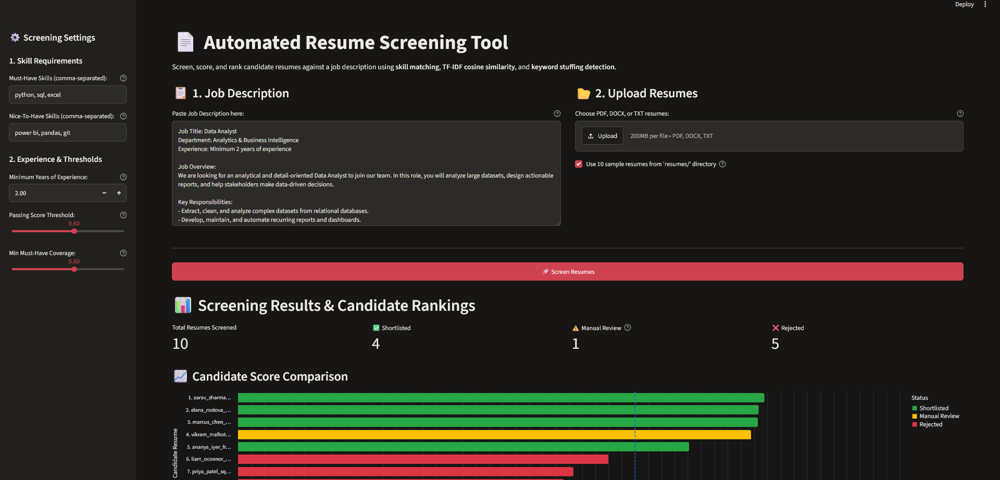

# Automated Resume Screening Tool 📄🔍

An intelligent, transparent, and reproducible automated resume screening and candidate ranking system built with Python, scikit-learn, and Streamlit. The tool parses multi-format resumes (`.pdf`, `.docx`, `.txt`), cleans unstructured text, extracts skills using alias-mapped regular expressions, assesses experience duration, calculates TF-IDF cosine similarity against target job descriptions, detects adversarial keyword stuffing, and provides decision recommendations.

> [!IMPORTANT]
> **Data Privacy & Synthetic Dataset Notice**: All candidate profiles, resumes, names, contact numbers, and employment histories in this project are **100% synthetic and generated programmatically for demonstration and evaluation purposes**. Any resemblance to real persons, living or dead, is entirely coincidental.

---

## 📌 Problem Statement

Recruitment teams receive hundreds or thousands of resumes for every technical job opening. Manual resume screening is:
1. **Time-Consuming**: Recruiters spend hours scanning text documents for foundational requirements.
2. **Inconsistent**: Fatigue and subjective judgment lead to uneven evaluations across candidates.
3. **Vulnerable to ATS Gaming**: Candidates often "keyword-stuff" resumes by repeating buzzwords in white text or hidden sections to artificially elevate match scores.
4. **Opaque**: Commercial black-box AI screeners frequently hide why candidates were accepted or rejected.

This project delivers an **auditable, explainable, and configurable resume screening pipeline** that combines rule-based skill verification, experience heuristics, and statistical natural language processing (TF-IDF).

---

## ✨ Features

- **Multi-Format Document Ingestion**:
  - Adobe PDF (`.pdf`) via `pdfplumber`
  - Microsoft Word (`.docx`) via `python-docx`
  - Plain Text (`.txt`) via UTF-8 standard reader
  - Ignores transient Office lock files (e.g., `~$*.docx`)
- **Text Cleaning & Preprocessing**:
  - Lowercasing, URL removal, email stripping, and whitespace collapse.
- **Skill Extraction Engine**:
  - Maps 12 canonical technical competencies to known aliases (`python`, `sql`, `excel`, `power bi`, `pandas`, `numpy`, `scikit-learn`, `machine learning`, `git`, `docker`, `aws`, `tableau`).
  - Strict whole-word regex matching (`\b...\b`) avoids false positives (e.g., `html` will not match `ml`, and `digital` will not match `git`).
  - Zero fuzzy matching to prevent inaccurate keyword attribution.
- **Experience Extraction**:
  - Identifies the maximum reported years of experience (supports integer and decimal values like `4 years`, `3.5 yrs`, `2+ years`).
- **Keyword Stuffing Detection**:
  - Flags resumes that repeat any individual skill beyond an acceptable threshold (default: 6 occurrences).
  - Automatically diverts qualified but keyword-stuffed candidates to `"Manual Review"` instead of automatic shortlisting.
- **Dual Interface**:
  - **CLI Pipeline (`main.py`)**: Batched terminal workflow with status summaries and automated CSV export.
  - **Interactive Web Dashboard (`app.py`)**: Streamlit application with custom criteria inputs, Altair visual bar charts, and one-click report downloads.

---

## 🛠️ Tech Stack

| Category | Technology / Library | Version | Purpose |
|---|---|---|---|
| **Language** | Python | 3.10+ (Tested on 3.12) | Core runtime environment |
| **Document Parsing** | `pdfplumber` | 0.11+ | PDF text and layout extraction |
| **Document Parsing** | `python-docx` | 1.2+ | DOCX paragraphs and table parsing |
| **NLP & ML** | `scikit-learn` | 1.9+ | TF-IDF vectorization & cosine similarity |
| **Data Processing** | `pandas`, `numpy` | 2.2+ / 2.5+ | DataFrames, metrics calculation, and CSV generation |
| **Web UI** | `streamlit` | 1.67+ | Interactive recruiter dashboard |
| **Data Visualization** | `altair` | 6.3+ | Status-colored ranking bar charts |

---

## 📁 Project Structure

```text
Automated Resume Screening Tool/
├── data/
│   └── job_description.txt       # Target Data Analyst job description
├── docs/                         # Project documentation and specifications
├── images/                       # Screenshots and dashboard visuals
│   ├── 03_terminal_output.png    # Terminal CLI execution output
│   └── 06_streamlit_dashboard.png# Streamlit web dashboard screenshot
├── outputs/                      # Generated screening reports
│   ├── ranking_report.csv        # Comprehensive ranking report
│   ├── shortlisted.csv           # Shortlisted candidates
│   └── rejected.csv              # Rejected candidates
├── resumes/                      # Synthetic candidate resumes (7 .txt, 3 .docx)
│   ├── aarav_sharma_data_analyst.txt
│   ├── ananya_iyer_fresher.txt
│   ├── carlos_ramirez_web_developer.txt
│   ├── elena_rostova_data_analyst.docx
│   ├── julian_vance_data_scientist.docx
│   ├── liam_oconnor_python_excel.docx
│   ├── marcus_chen_data_analyst.txt
│   ├── priya_patel_sql_excel.txt
│   ├── sophie_dubois_marketing.txt
│   └── vikram_malhotra_keyword_stuffed.txt
├── src/                          # Modular source code
│   ├── __init__.py
│   ├── cleaner.py                # Text cleaning & normalization
│   ├── extractor.py              # Resume file discovery & text reading
│   ├── scorer.py                 # TF-IDF, experience scoring & ranking
│   └── skills.py                 # Skill dictionary, regex extraction & stuffing check
├── app.py                        # Streamlit interactive application
├── generate_samples.py           # Script to create the 10 synthetic resumes
├── main.py                       # CLI execution pipeline
├── requirements.txt              # Production dependencies
├── .gitignore                    # Python, IDE, and OS exclusion patterns
└── README.md                     # Project documentation
```

---

## 🚀 How to Run

### Prerequisites
- Python 3.10, 3.11, or 3.12 installed on your system.
- Git (optional, for cloning).

---

### On Windows (PowerShell / Command Prompt)

1. **Clone or Navigate to the Project Directory**:
   ```powershell
   cd "c:\Users\<YourUser>\Documents\IIP Projects\Python\Automated Resume Screening Tool"
   ```

2. **Create and Activate a Virtual Environment**:
   ```powershell
   python -m venv venv
   .\venv\Scripts\Activate.ps1
   ```
   *(If script execution is disabled in PowerShell, run `Set-ExecutionPolicy -Scope Process -ExecutionPolicy Bypass` first).*

3. **Install Dependencies**:
   ```powershell
   pip install -r requirements.txt
   ```

4. **Generate Synthetic Resumes & Sample Job Description**:
   ```powershell
   python generate_samples.py
   ```

5. **Run the CLI Screening Pipeline**:
   ```powershell
   python main.py
   ```

6. **Launch the Streamlit Web Application**:
   ```powershell
   streamlit run app.py
   ```
   *The application will open automatically in your browser at `http://localhost:8501`.*

---

### On macOS / Linux (Terminal)

1. **Navigate to the Project Directory**:
   ```bash
   cd "Automated Resume Screening Tool"
   ```

2. **Create and Activate a Virtual Environment**:
   ```bash
   python3 -m venv venv
   source venv/bin/activate
   ```

3. **Install Dependencies**:
   ```bash
   pip install -r requirements.txt
   ```

4. **Generate Synthetic Resumes**:
   ```bash
   python3 generate_samples.py
   ```

5. **Run the CLI Pipeline**:
   ```bash
   python3 main.py
   ```

6. **Launch Streamlit**:
   ```bash
   streamlit run app.py
   ```

---

## 🧮 Scoring Formula & Decision Logic

Each candidate is evaluated across four weighted dimensions:

$$\text{Composite Score} = (0.50 \times \text{MC}) + (0.15 \times \text{NC}) + (0.25 \times \text{Sim}) + (0.10 \times \text{Exp})$$

### Components

1. **Must-Have Skill Coverage ($\text{MC}$)** — **50% Weight**:
   $$\text{MC} = \frac{|\text{Matched Must-Have Skills}|}{|\text{Total Must-Have Skills}|}$$
2. **Nice-to-Have Skill Coverage ($\text{NC}$)** — **15% Weight**:
   $$\text{NC} = \frac{|\text{Matched Nice-To-Have Skills}|}{|\text{Total Nice-To-Have Skills}|}$$
3. **TF-IDF Cosine Similarity ($\text{Sim}$)** — **25% Weight**:
   - Resumes and the job description are transformed into TF-IDF vector spaces using word unigrams and bigrams (`ngram_range=(1, 2)`) with standard English stop words removed.
   - Cosine similarity measures topical overlap:
     $$\text{Sim} = \frac{\mathbf{v}_{\text{resume}} \cdot \mathbf{v}_{\text{JD}}}{\|\mathbf{v}_{\text{resume}}\| \|\mathbf{v}_{\text{JD}}\|}$$
4. **Experience Score ($\text{Exp}$)** — **10% Weight**:
   $$\text{Exp} = \min\left(\frac{\text{Years Extracted}}{\text{Minimum Required Years}}, 1.0\right)$$

### Decision Thresholds

| Decision | Condition | Explanation |
|---|---|---|
| **`Shortlisted`** | $\text{MC} \ge 0.60$ **AND** $\text{Score} \ge 0.60$ **AND** $\text{Keyword Stuffed} = \text{False}$ | Candidate possesses core competencies, relevant background, and adequate experience. |
| **`Manual Review`** | $\text{MC} \ge 0.60$ **AND** $\text{Score} \ge 0.60$ **AND** $\text{Keyword Stuffed} = \text{True}$ | Candidate passed the mathematical threshold but repeated keywords excessively (> 6 times). Diverted for human audit. |
| **`Rejected`** | $\text{MC} < 0.60$ **OR** $\text{Score} < 0.60$ | Candidate lacks required foundational skills or overall profile relevance. |

---

## 📊 Sample Outputs

### 1. Terminal CLI Output (`main.py`)


*Figure 1: Terminal table rendering candidate ranks, TF-IDF similarity, coverage ratios, and status distribution summaries.*

```text
================================================================================
 RANKED SCREENING RESULTS
================================================================================
Rank  | Resume                              | Score   | TF-IDF  | MustCov | Exp   | Status        
------------------------------------------------------------------------------------------
1     | aarav_sharma_data_analyst.txt       | 0.7955  | 0.1818  | 1.00    | 4.0   | Shortlisted   
2     | elena_rostova_data_analyst.docx     | 0.7869  | 0.1478  | 1.00    | 3.5   | Shortlisted   
3     | marcus_chen_data_analyst.txt        | 0.7859  | 0.1435  | 1.00    | 3.0   | Shortlisted   
4     | vikram_malhotra_keyword_stuffed.txt | 0.7756  | 0.1025  | 1.00    | 2.0   | Manual Review 
5     | ananya_iyer_fresher.txt             | 0.6820  | 0.1279  | 1.00    | 0.0   | Shortlisted   
6     | liam_oconnor_python_excel.docx      | 0.5600  | 0.1067  | 0.67    | 2.5   | Rejected      
7     | priya_patel_sql_excel.txt           | 0.5069  | 0.0944  | 0.67    | 3.0   | Rejected      
8     | julian_vance_data_scientist.docx    | 0.4924  | 0.0362  | 0.67    | 5.0   | Rejected      
9     | carlos_ramirez_web_developer.txt    | 0.1546  | 0.0185  | 0.00    | 4.0   | Rejected      
10    | sophie_dubois_marketing.txt         | 0.1032  | 0.0130  | 0.00    | 4.0   | Rejected      
```

### 2. Streamlit Web Dashboard (`app.py`)



*Figure 2: Interactive Streamlit UI featuring job description editor, file uploader, KPI metric cards, Altair comparative bar chart, interactive ranking table, and CSV download.*

---

## ⚖️ Limitations & Ethical Considerations

> [!CAUTION]
> **Human-in-the-Loop Principle**: This software is strictly an **automated prioritization and screening aid**, **never an autonomous hiring authority**. Final interview, hiring, or rejection actions must always be reviewed and decided by human recruitment personnel.

1. **Bias Mitigation by Design**:
   - The extraction and scoring algorithms evaluate **only** technical skill mentions, quantified years of experience, and vocabulary overlap with the job description.
   - **No demographic attributes** (candidate names, gender pronouns, age, photographs, physical addresses, or graduation years) influence the ranking score.
2. **Synthetic Data**:
   - All sample resumes were synthetically engineered for testing. Real-world resumes contain much wider variance in layout, formatting, typography, and phrasing.
3. **Absence of Optical Character Recognition (OCR)**:
   - Scanned or image-only PDFs (where text is embedded as bitmap images) will not yield extractable text using standard stream readers.
4. **Semantics vs. Context**:
   - While TF-IDF measures word frequency and n-gram overlap, it does not fully capture semantic synonyms (e.g., understanding that "building ETL pipelines" relates closely to "data engineering") without an explicit alias mapping.

---

## 🔮 Future Improvements

- [ ] **Transformer Embeddings**: Incorporate dense semantic embeddings (e.g., `all-MiniLM-L6-v2` via `sentence-transformers`) alongside TF-IDF to capture conceptual similarity.
- [ ] **OCR Support**: Integrate `pytesseract` and `pdf2image` to process scanned and flattened resume PDFs.
- [ ] **Education Level Extraction**: Add heuristic classification for degrees (B.S., M.S., Ph.D.) and relevant academic disciplines.
- [ ] **Section-Aware Parsing**: Segment resumes into explicit sections (`Experience`, `Education`, `Projects`) to weight recent job roles higher than older coursework.
- [ ] **Recruiter Feedback Loop**: Allow recruiters to adjust skill weights directly from the UI and export configuration templates.

---

## 🎓 Learning Outcomes

Through this project, key technical competencies developed include:
1. **Unstructured Data Ingestion**: Managing format-specific parsers (`pdfplumber` and `python-docx`) and defensive exception handling across Windows and POSIX systems.
2. **Regular Expression Design**: Building compound regex patterns with negative word boundary guards to avoid substring collisions.
3. **Statistical NLP**: Applying TF-IDF term weighting and cosine similarity matrices across uneven document collections.
4. **Adversarial Input Handling**: Implementing heuristic boundary detection to catch keyword stuffing attempts.
5. **Interactive Data Product Development**: Building an end-to-end user experience in Streamlit with dynamic visualizations and session state persistence.
