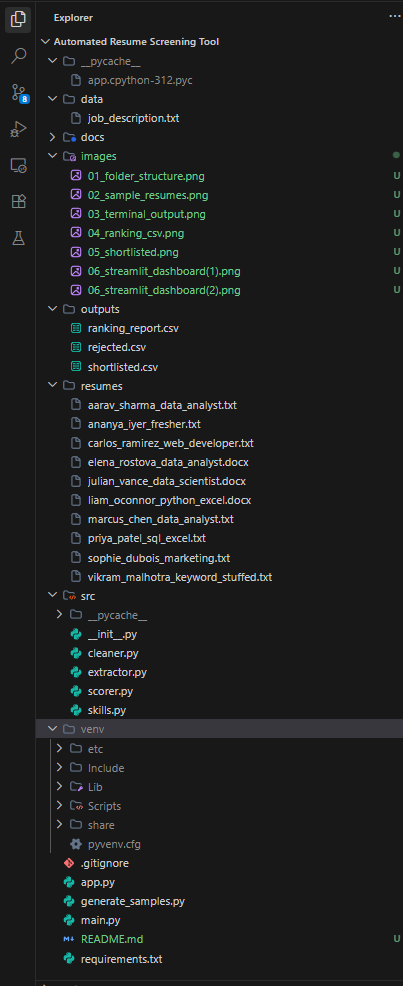
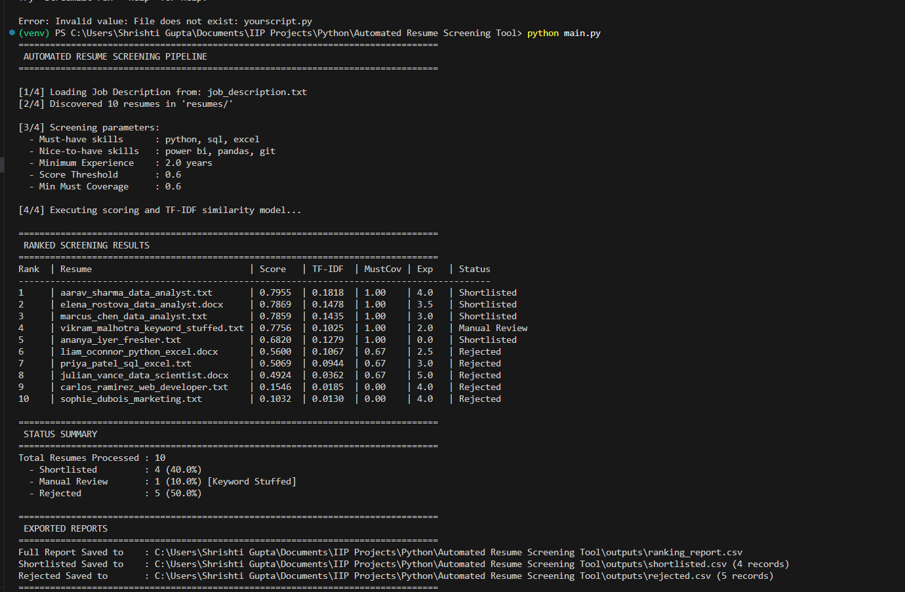
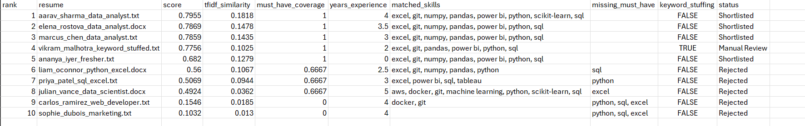
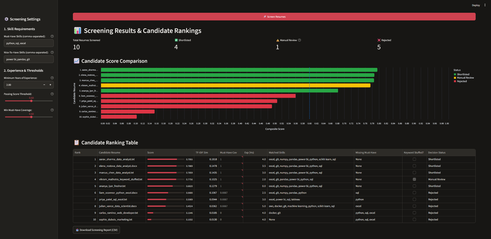

# Automated Resume Screening Tool 📄🔍

An automated resume screening and candidate ranking application built with Python, scikit-learn, and Streamlit. The tool parses multi-format resumes (`.pdf`, `.docx`, `.txt`), normalizes unstructured text, extracts skills using canonical alias-mapped regular expressions, parses years of experience, calculates TF-IDF cosine similarity against target job descriptions, detects adversarial keyword stuffing, and produces ranked reports for recruitment workflows.

> [!IMPORTANT]
> **Synthetic Dataset & Ethical Notice**: All resumes, candidate profiles, and contact details in this repository are **100% synthetic** and programmatically generated for demonstration, testing, and evaluation purposes. **Scores and rankings generated by this tool are strictly a ranking aid to help recruiters prioritize reviews; a human recruiter must always make final screening, interview, and hiring decisions.**

---

## 📌 Problem Statement

Recruitment teams often handle dozens or hundreds of applications for every open position. Manual screening faces multiple recurring challenges:
1. **Inefficient Manual Review**: Scanning dozens of unstructured documents across multiple file formats takes hours of recruiter time.
2. **Inconsistent Evaluation**: Human evaluation fluctuates under fatigue, leading to uneven evaluations across candidates.
3. **ATS Gaming (Keyword Stuffing)**: Applicants sometimes repeat required keywords dozens of times (in footers, white text, or repeated lists) to manipulate keyword-based screening systems.
4. **Lack of Transparency**: Many automated tools function as opaque black boxes without explaining why candidates scored high or low.

This project addresses these challenges with a **deterministic, transparent, and auditable screening workflow** combining rule-based skill verification, experience heuristics, and TF-IDF statistical text similarity.

---

## ✨ Features

- **Multi-Format Ingestion**:
  - Adobe PDF (`.pdf`) parsed via `pdfplumber`.
  - Microsoft Word (`.docx`) parsed via `python-docx` (paragraphs and tables).
  - Plain Text (`.txt`) read via standard UTF-8 stream readers.
  - Automatically skips temporary Office lock files (e.g., `~$*.docx`).
- **Text Normalization**:
  - Lowercases characters, strips email addresses and web URLs, and collapses redundant whitespace.
- **Strict Skill Extraction (No Fuzzy False Positives)**:
  - Maps 12 canonical technical competencies to known aliases (`python`, `sql`, `excel`, `power bi`, `pandas`, `numpy`, `scikit-learn`, `machine learning`, `git`, `docker`, `aws`, `tableau`).
  - Employs strict whole-word regular expressions (`\b...\b`) with aliases sorted longest-first to prevent prefix collisions (e.g., matching `postgresql` and `t-sql` before `sql`).
  - Avoids fuzzy string matching entirely to eliminate false-positive matches (e.g., `html` will never match `ml`, `digital` will never match `git`, and `excellent` will never match `excel`).
- **Experience Parsing**:
  - Extracts reported experience durations in years (supporting integers and decimals like `4 years`, `3.5 yrs`, `2+ years`).
- **Keyword Stuffing Detection**:
  - Tracks whole-word frequency counts per skill.
  - Automatically flags resumes repeating any single skill beyond an acceptable limit (default: 6 occurrences).
- **Dual Recruiter Interfaces**:
  - **CLI Pipeline (`main.py`)**: Runs batch evaluation, outputs ranked terminal tables, and automatically exports clean CSV reports.
  - **Streamlit Web Dashboard (`app.py`)**: Interactive web interface with editable job descriptions, multi-file uploaders, metric cards, Altair score bar charts, and one-click report downloads.
- **Transparent Decision Categories**:
  - Candidates are categorized as **`Shortlisted`**, **`Manual Review`** (for candidates passing score thresholds but flagged for keyword stuffing), or **`Rejected`**.

---

## 🛠️ Tech Stack

| Technology | Purpose |
|---|---|
| **Python** (3.10+) | Core programming language and runtime |
| **pandas** | Data manipulation, ranking table structuring, and CSV generation |
| **scikit-learn** | `TfidfVectorizer` (unigrams + bigrams, English stop words) and `cosine_similarity` |
| **pdfplumber** | Accurate text extraction from PDF documents |
| **python-docx** | Programmatic reading and writing of Microsoft Word (.docx) files |
| **regex (`re`)** | Whole-word boundary matching, token cleanup, and keyword stuffing detection |
| **Streamlit** | Interactive browser-based user interface for recruiters |

Built with AI-assisted code generation in Antigravity IDE; all code was reviewed and tested by me.

---

## 📁 Folder Structure

```text
Automated Resume Screening Tool/
├── data/
│   └── job_description.txt       # Target Data Analyst job description
├── docs/                         # Additional project notes
├── images/                       # UI screenshots and visual assets
│   ├── 01_folder_structure.png
│   ├── 02_sample_resumes.png
│   ├── 03_terminal_output.png
│   ├── 04_ranking_csv.png
│   ├── 05_shortlisted.png
│   ├── 06_streamlit_dashboard.png
│   └── 07_ranking_table.png
├── outputs/                      # Generated screening CSV reports
│   ├── ranking_report.csv        # Complete ranking report across all candidates
│   ├── shortlisted.csv           # Shortlisted candidates meeting all criteria
│   └── rejected.csv              # Candidates below threshold or missing must-haves
├── resumes/                      # 10 synthetic candidate resumes (7 .txt, 3 .docx)
│   ├── aarav_sharma_data_analyst.txt
│   ├── ananya_iyer_fresher.txt
│   ├── carlos_ramirez_web_developer.txt
│   ├── elena_rostova_data_analyst.docx
│   ├── julian_vance_data_scientist.docx
│   ├── liam_oconnor_python_excel.docx
│   ├── marcus_chen_data_analyst.txt
│   ├── priya_patel_sql_excel.txt
│   ├── sophie_dubois_marketing.txt
│   └── vikram_malhotra_keyword_stuffed.txt
├── src/                          # Modular backend components
│   ├── __init__.py
│   ├── cleaner.py                # Lowercasing, URL/email stripping, whitespace collapse
│   ├── extractor.py              # File discovery and multi-format text readers
│   ├── scorer.py                 # TF-IDF, coverage weights, experience scoring, and ranking
│   └── skills.py                 # Canonical skills dictionary, regex extractor, stuffing check
├── app.py                        # Streamlit web dashboard
├── generate_samples.py           # Synthetic data generator script
├── main.py                       # CLI batch execution pipeline
├── requirements.txt              # Project dependencies
└── README.md                     # Documentation
```

---

## 🚀 Installation & How to Run

### 1. Prerequisites
- Python 3.10, 3.11, or 3.12 installed on your system.
- Git (optional, for cloning).

---

### Windows (PowerShell / Command Prompt)

1. **Create and Activate Virtual Environment**:
   ```powershell
   python -m venv venv
   .\venv\Scripts\activate
   ```

2. **Install Dependencies**:
   ```powershell
   pip install -r requirements.txt
   ```

3. **Generate Synthetic Resumes**:
   ```powershell
   python generate_samples.py
   ```

4. **Run CLI Screening Pipeline**:
   ```powershell
   python main.py
   ```

5. **Launch Streamlit Web App**:
   ```powershell
   python -m streamlit run app.py
   ```

---

### Mac / Linux (Terminal)

1. **Create and Activate Virtual Environment**:
   ```bash
   python3 -m venv venv
   source venv/bin/activate
   ```

2. **Install Dependencies**:
   ```bash
   pip install -r requirements.txt
   ```

3. **Generate Synthetic Resumes**:
   ```bash
   python3 generate_samples.py
   ```

4. **Run CLI Screening Pipeline**:
   ```bash
   python3 main.py
   ```

5. **Launch Streamlit Web App**:
   ```bash
   python3 -m streamlit run app.py
   ```

---

## 🧮 Scoring Formula & Decision Rules

Each candidate resume is scored against the job description using a normalized weighted equation:

$$\text{Composite Score} = (0.50 \times \text{Must-Have Coverage}) + (0.15 \times \text{Nice-To-Have Coverage}) + (0.25 \times \text{TF-IDF Similarity}) + (0.10 \times \text{Experience Score})$$

### Term Definitions

1. **Must-Have Coverage ($0.50$ Weight)**:
   $$\text{Must-Have Coverage} = \frac{|\text{Matched Must-Have Skills}|}{|\text{Total Must-Have Skills}|}$$
2. **Nice-to-Have Coverage ($0.15$ Weight)**:
   $$\text{Nice-To-Have Coverage} = \frac{|\text{Matched Nice-To-Have Skills}|}{|\text{Total Nice-To-Have Skills}|}$$
3. **TF-IDF Similarity ($0.25$ Weight)**:
   - Resumes and the job description are vectorized with `TfidfVectorizer(ngram_range=(1, 2), stop_words='english')`.
   - Cosine similarity measures lexical overlap between candidate text and the job description:
     $$\text{Cosine Similarity} = \frac{\mathbf{u}_{\text{resume}} \cdot \mathbf{v}_{\text{JD}}}{\|\mathbf{u}_{\text{resume}}\| \|\mathbf{v}_{\text{JD}}\|}$$
4. **Experience Score ($0.10$ Weight)**:
   $$\text{Experience Score} = \min\left(\frac{\text{Candidate Experience Years}}{\text{Minimum Required Years}}, 1.0\right)$$

---

### Decision Rules

Screening outcomes are categorized based on explicit, transparent criteria:

| Status | Rule Conditions | Description |
|---|---|---|
| **`Shortlisted`** | $\text{Must-Have Coverage} \ge 0.60$ **AND** $\text{Score} \ge \text{Threshold}$ (default $0.60$) **AND** $\text{Keyword Stuffed} = \text{False}$ | Candidate possesses required core skills, adequate experience, and strong textual alignment. |
| **`Manual Review`** | $\text{Must-Have Coverage} \ge 0.60$ **AND** $\text{Score} \ge \text{Threshold}$ (default $0.60$) **AND** $\text{Keyword Stuffed} = \text{True}$ | Candidate met score thresholds but triggered keyword stuffing heuristics (> 6 skill repetitions). Diverted for human audit. |
| **`Rejected`** | $\text{Must-Have Coverage} < 0.60$ **OR** $\text{Score} < \text{Threshold}$ (default $0.60$) | Candidate lacks sufficient core competencies or profile alignment for the role. |

---

## 📊 Sample Output

### Terminal CLI Execution (`python main.py`)

```text
================================================================================
 AUTOMATED RESUME SCREENING PIPELINE
================================================================================

[1/4] Loading Job Description from: job_description.txt
[2/4] Discovered 10 resumes in 'resumes/'

[3/4] Screening parameters:
  - Must-have skills      : python, sql, excel
  - Nice-to-have skills   : power bi, pandas, git
  - Minimum Experience    : 2.0 years
  - Score Threshold       : 0.6
  - Min Must Coverage     : 0.6

[4/4] Executing scoring and TF-IDF similarity model...

================================================================================
 RANKED SCREENING RESULTS
================================================================================
Rank  | Resume                              | Score   | TF-IDF  | MustCov | Exp   | Status        
------------------------------------------------------------------------------------------
1     | aarav_sharma_data_analyst.txt       | 0.7955  | 0.1818  | 1.00    | 4.0   | Shortlisted   
2     | elena_rostova_data_analyst.docx     | 0.7869  | 0.1478  | 1.00    | 3.5   | Shortlisted   
3     | marcus_chen_data_analyst.txt        | 0.7859  | 0.1435  | 1.00    | 3.0   | Shortlisted   
4     | vikram_malhotra_keyword_stuffed.txt | 0.7756  | 0.1025  | 1.00    | 2.0   | Manual Review 
5     | ananya_iyer_fresher.txt             | 0.6820  | 0.1279  | 1.00    | 0.0   | Shortlisted   
6     | liam_oconnor_python_excel.docx      | 0.5600  | 0.1067  | 0.67    | 2.5   | Rejected      
7     | priya_patel_sql_excel.txt           | 0.5069  | 0.0944  | 0.67    | 3.0   | Rejected      
8     | julian_vance_data_scientist.docx    | 0.4924  | 0.0362  | 0.67    | 5.0   | Rejected      
9     | carlos_ramirez_web_developer.txt    | 0.1546  | 0.0185  | 0.00    | 4.0   | Rejected      
10    | sophie_dubois_marketing.txt         | 0.1032  | 0.0130  | 0.00    | 4.0   | Rejected      

================================================================================
 STATUS SUMMARY
================================================================================
Total Resumes Processed : 10
  - Shortlisted         : 4 (40.0%)
  - Manual Review       : 1 (10.0%) [Keyword Stuffed]
  - Rejected            : 5 (50.0%)

================================================================================
 EXPORTED REPORTS
================================================================================
Full Report Saved to    : outputs/ranking_report.csv
Shortlisted Saved to    : outputs/shortlisted.csv (4 records)
Rejected Saved to       : outputs/rejected.csv (5 records)
================================================================================
```

---

## 📸 Screenshots

### Project Workspace & Folder Structure


### Terminal Pipeline Output


### Generated Ranking CSV Report (`outputs/ranking_report.csv`)


### Shortlisted Candidates CSV (`outputs/shortlisted.csv`)


### Streamlit Web Dashboard Overview


### Candidate Ranking & Evaluation Table


---

## ⚖️ Limitations & Ethics

1. **Synthetic Data**:
   - All 10 candidate resumes in this project are **100% synthetic**. They were engineered specifically to validate diverse screening conditions (strong matches, partial matches, freshers, mismatched profiles, and keyword stuffing).
2. **Human in the Loop**:
   - Scores and rankings are an **objective ranking aid** to help recruitment teams prioritize high volumes of incoming applications.
   - **A human recruiter must always review candidate details and make the final decision.** The tool does not make automated employment decisions.
3. **No Name / Gender / Age Signals**:
   - The extraction and scoring models evaluate **only** technical competencies, numerical years of experience, and vocabulary similarity against the job description.
   - Candidate names, email domains, phone numbers, pronouns, age, address, and demographic attributes are never used in scoring.
4. **Document Formatting Boundaries**:
   - The tool parses text streams from standard PDF, DOCX, and TXT files. It does not perform Optical Character Recognition (OCR) on flattened, scanned bitmap images.
5. **Exact Vocabulary vs. Context**:
   - Skills are matched using whole-word regex against an explicit canonical alias dictionary. Unlisted synonyms or acronyms outside the dictionary are not detected.
6.

---

## 🔮 Future Improvements

- [ ] **Semantic Embeddings**: Integrate transformer-based sentence embeddings (e.g., `sentence-transformers`) to augment TF-IDF with dense contextual similarity.
- [ ] **OCR Engine**: Add `tesseract` / `pdf2image` support to ingest scanned, non-searchable PDF resumes.
- [ ] **Education Level Extraction**: Implement rule-based classification to identify degree levels (B.S., M.S., Ph.D.) and academic majors.
- [ ] **Section-Weighted Analysis**: Segment resume text into sections (Experience, Education, Projects) to give higher scoring weight to professional experience over older coursework.
- [ ] **Configurable Alias Editor**: Allow recruiters to add custom canonical skills and alias terms directly from the Streamlit interface.

---

## 🎓 Learning Outcomes

Key engineering and machine learning concepts demonstrated in this project:
- **Document Text Extraction**: Parsing text streams, tables, and paragraphs across `.pdf`, `.docx`, and `.txt` files in Python.
- **Robust Regular Expression Engineering**: Implementing boundary-guarded whole-word regex matching without fuzzy matching to prevent false positives.
- **Applied Natural Language Processing**: Applying TF-IDF vectorization with unigrams and bigrams, stop word filtering, and cosine similarity calculations with scikit-learn.
- **Defensive Heuristics**: Engineering keyword stuffing detection to safeguard against ATS manipulation.
- **Safe Cross-Platform File Operations**: Handling temporary files cleanly and safely on Windows and POSIX systems.
- **Interactive Recruiter UI**: Building a Streamlit application with Altair data visualizations, progress indicators, and CSV report export.
