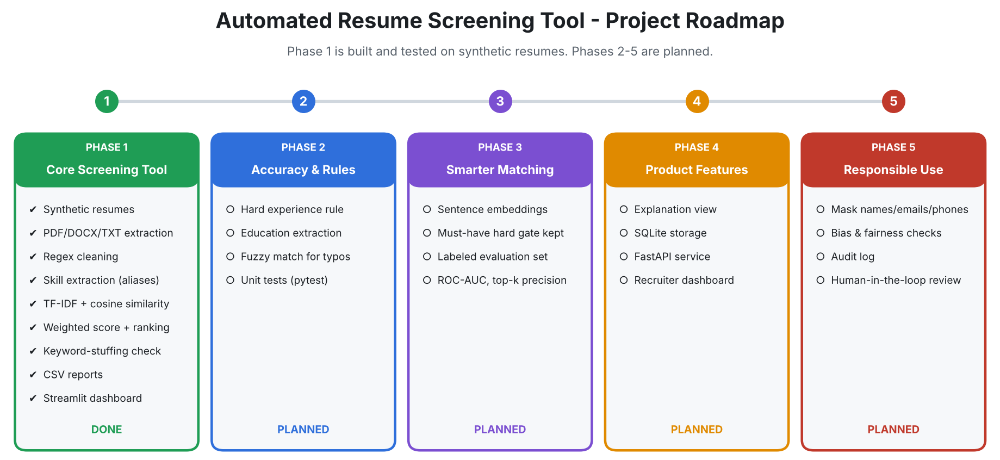
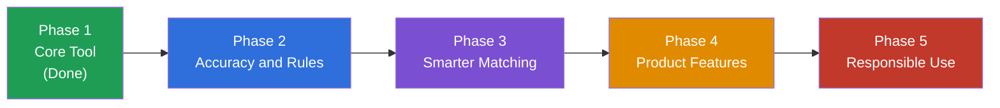

# Project Roadmap

> Phase 1 is built and tested on **synthetic resumes**. Phases 2-5 are planned and not yet implemented.

## Status at a glance

| Phase | Focus | Status |
|---|---|---|
| 1 | Core screening tool | Completed |
| 2 | Accuracy and rules | Planned |
| 3 | Smarter matching | Planned |
| 4 | Product features | Planned |
| 5 | Responsible use | Planned |

## Flow of the plan

## Phase 1: Core Screening Tool (Completed)
- [x] Project setup, virtual environment, GitHub repository
- [x] Synthetic resume generator (TXT and DOCX)
- [x] Text extraction from PDF, DOCX and TXT
- [x] Text cleaning with regex
- [x] Skill extraction using aliases and whole-word matching
- [x] TF-IDF and cosine similarity scoring
- [x] Weighted score, ranking and shortlist rules
- [x] Keyword-stuffing detection (sent to Manual Review)
- [x] CSV reports (ranking, shortlisted, rejected)
- [x] Streamlit dashboard with score chart and CSV download

## Phase 2: Accuracy and Rules (Planned)
- [ ] Make minimum experience a hard rule (freshers go to Manual Review)
- [ ] Extract education (degree and field)
- [ ] Add fuzzy matching for skill typos
- [ ] Add unit tests for extractor, skills and scorer

## Phase 3: Smarter Matching (Planned)
- [ ] Replace TF-IDF with sentence-transformer embeddings
- [ ] Keep must-have skills as a hard gate alongside embeddings
- [ ] Build a small labeled dataset
- [ ] Report ROC-AUC and top-k precision

## Phase 4: Product Features (Planned)
- [ ] Explanation view: matched and missing skills per candidate
- [ ] Store jobs, candidates and rankings in SQLite
- [ ] FastAPI service (create job, upload resume, rank candidates)
- [ ] Recruiter dashboard on top of the API

## Phase 5: Responsible Use (Planned)
- [ ] Mask names, emails and phone numbers before scoring
- [ ] Bias and fairness checks on non-sensitive slices
- [ ] Audit log of ranking decisions
- [ ] Human-in-the-loop review step before any final decision

## Known limitations that drive this roadmap
- Keyword matching can miss synonyms and context.
- Experience is a soft factor in the score, so freshers with strong skill matches can still be shortlisted.
- Tested only on synthetic data, not on real hiring outcomes.
